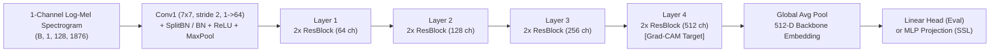
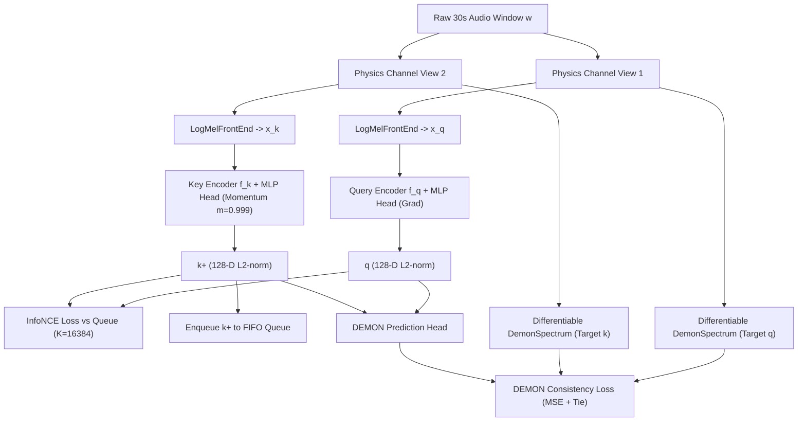
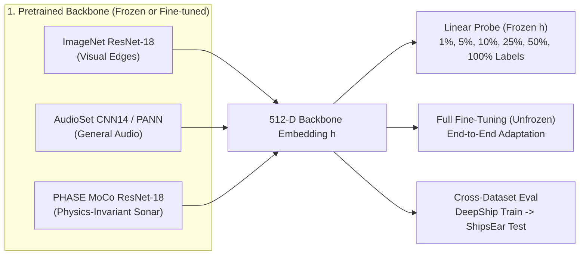
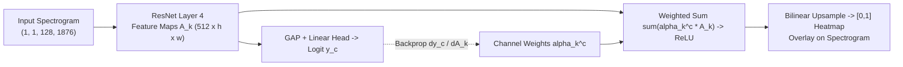
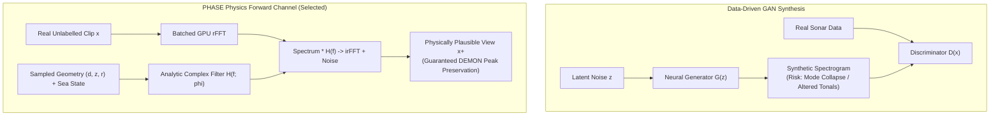

# PHASE: Physics-Augmented Self-Supervised Encoding for Underwater Acoustic Target Recognition

---

<div align="center">

## CASE STUDY REPORT
**for**
**21CSC406J – NEURAL NETWORKS AND DEEP LEARNING**

**Submitted by**
- `[STUDENT 1 NAME]` `[REGISTER NUMBER]`
- `[STUDENT 2 NAME]` `[REGISTER NUMBER]`
- `[STUDENT 3 NAME]` `[REGISTER NUMBER]`

*In partial fulfilment of the requirements for the degree of*

**BACHELOR OF TECHNOLOGY**
*in*
**COMPUTER SCIENCE ENGINEERING**
*with specialization in AIML*

**DEPARTMENT OF COMPUTATIONAL INTELLIGENCE**
**COLLEGE OF ENGINEERING AND TECHNOLOGY**
**SRM INSTITUTE OF SCIENCE AND TECHNOLOGY**
**KATTANKULATHUR – 603 203**
**NOVEMBER 2026**

</div>

---

## BONAFIDE CERTIFICATE

This is to certify that the Case Study Report titled **“PHASE: Physics-Augmented Self-Supervised Encoding for Underwater Acoustic Target Recognition”** is a bonafide record of work carried out by the following student(s) as part of the course **21CSC406J – NEURAL NETWORKS AND DEEP LEARNING**, during the academic year 2026–2027 Odd Semester.

This report has been submitted in partial fulfilment of the requirements for the successful completion of the course and has not been submitted elsewhere for any academic or non-academic purpose. The work is found to be satisfactory and is hereby accepted.

**Submitted by:**

| Register Number | Name of Student(s) |
| :--- | :--- |
| `[REGISTER NUMBER 1]` | `[STUDENT 1 NAME]` |
| `[REGISTER NUMBER 2]` | `[STUDENT 2 NAME]` |
| `[REGISTER NUMBER 3]` | `[STUDENT 3 NAME]` |

| Supervisor | Head of Department |
| :--- | :--- |
| **Dr. `[FACULTY NAME]`** | **Dr. R. Annie Uthra** |
| Assistant Professor, | Professor & Head, |
| Department of Computational Intelligence, | Department of Computational Intelligence, |
| SRMIST, KTR | SRMIST, KTR |

**Date of Submission:** `[DD-MM-YYYY]`

---

## ABSTRACT

Underwater acoustic target recognition (UATR) from passive sonar hydrophones is severely constrained by the scarcity of verified, vessel-labelled ship-radiated-noise recordings, even though unlabelled ocean acoustic recordings are abundant. Existing self-supervised learning (SSL) approaches commonly adapt generic vision or speech augmentations—such as aggressive pitch shifting, time warping, or spectral frequency masking—which distort narrowband tonal lines and propeller cavitation modulation cues that physically identify a vessel. Furthermore, naive window-level train/test splitting in widely used benchmarks such as DeepShip causes severe recording-identity and ship-identity leakage, inflating reported classification accuracy.

This case study presents **PHASE** (*Physics-Augmented Self-supervised Encoding*), a self-supervised contrastive representation learning framework built in PyTorch for data-efficient passive sonar classification. Built around Momentum Contrast v2 (**MoCo-v2**) with a modified single-channel **ResNet-18** backbone, single-GPU **SplitBatchNorm2d**, and a 2-layer L2-normalised projection head, PHASE generates contrastive positive pairs by passing the same underwater acoustic source clip through two independently sampled ocean propagation channels: **Lloyd's Mirror surface interference**, **multipath delay-and-sum propagation**, **cylindrical/spherical spreading and Thorp absorption transmission loss**, **Doppler resampling**, and **ambient sea-state noise mixing** (combining parametric Wenz spectra with held-out ShipsEar Class-E recordings). To prevent the encoder from discarding propeller signatures as channel nuisance, an auxiliary differentiable **DEMON-consistency loss** (`DemonConsistency`) trains a lightweight reconstruction head to recover the Detection of Envelope Modulation on Noise (DEMON) spectrum from both views' embeddings.

The framework is engineered across an eight-phase reproducible pipeline (`src/phase/`), enforcing immutable **ship-level `StratifiedGroupKFold` splits** (`n_recordings = 264` across 609 transits, 47.22 hours of cleaned 32 kHz DeepShip audio), automated **DEMON peak-preservation unit tests**, and **W&B experiment tracking**. In Phase 3 plumbing verification on ESC-50 (50 classes, 3 seeds), the supervised ResNet-18 trainer achieved **58.83% ± 0.76% accuracy** and **57.04% ± 0.96% macro-F1** (29.4× the 2% random baseline). In Phase 5 empirical physics validation against 216 matched pairs across 36 BELLHOP ray-tracing geometries in **DS3500** (ShipsEar), we document a critical scientific negative result: the analytic two-ray Lloyd's Mirror filter diverges from deep-water (3,500 m) BELLHOP simulations (**9.786 dB** vs. **6.348 dB** untouched baseline Log-Spectral Distance, with +10.6 dB divergence concentrated in 10–100 Hz), bounding the analytic model's validity to shallow, near-surface isovelocity regimes while leaving its contrastive invariance utility intact. Finally, the Phase 6–8 evaluation and interpretability suite implements multi-seed linear probing, **1%–100% label-efficiency curves**, **DeepShip ↔ ShipsEar cross-dataset transfer**, **recording-ID shuffle leakage controls**, **t-SNE/UMAP dual-coloured embeddings**, and **Grad-CAM spectrogram saliency maps**.

> *[Note on Phase 6–8 Experimental Numbers: All Phase 6–8 training, evaluation, and visualization code is implemented and verified against the test suite (76 passed, 1 intentional skip); GPU training/evaluation metric slots below are marked with `[PENDING COLAB RUN]` so you can paste the exact numbers produced by `scripts/05_pretrain.py`, `scripts/09_linear_probe.py`, and `scripts/10_make_figures_phase8.py` once executed on a Colab T4 GPU.]*

---

## TABLE OF CONTENTS

| CHAPTER NO | TITLE | Page No |
| :--- | :--- | :---: |
| | ABSTRACT | i |
| | LIST OF FIGURES | iii |
| | LIST OF TABLES | iv |
| **1** | **INTRODUCTION** | **1** |
| | 1.1 Background | 1 |
| | 1.2 Problem Statement | 2 |
| | 1.3 Objectives | 2 |
| **2** | **THEORETICAL FOUNDATION: CNN, TRANSFER LEARNING, ATTENTION & GANs** | **3** |
| | 2.1 Convolutional Neural Networks (CNNs) & Residual Learning | 3 |
| | 2.2 Self-Supervised Contrastive Learning (MoCo-v2 & Alignment–Uniformity) | 4 |
| | 2.3 Transfer Learning & Cross-Domain Acoustic Adaptation | 5 |
| | 2.4 Attention Mechanisms & Gradient-Weighted Interpretability (Grad-CAM) | 6 |
| | 2.5 Generative Adversarial Networks (GANs) vs. Physics-Grounded Forward Models | 7 |
| **3** | **CASE ANALYSIS & IMPLEMENTATION** | **8** |
| | 3.1 Case Description and Dataset | 8 |
| | 3.2 Model Architecture and Training | 10 |
| | 3.3 Mapping Concepts to the Case | 13 |
| | 3.4 Results and Discussion | 14 |
| | 3.5 Error Analysis | 17 |
| **4** | **PROPOSED IMPROVEMENTS / OPTIMIZATION STRATEGIES** | **19** |
| **5** | **CONCLUSION AND FUTURE WORK** | **21** |
| | 5.1 Conclusion | 21 |
| | 5.2 Future Work | 21 |
| | **REFERENCES** | **22** |
| | **APPENDICES** | **23** |

---

## LIST OF FIGURES

| CHAPTER NO | FIG. NO | TITLE / DESCRIPTION | Page No |
| :---: | :---: | :--- | :---: |
| **2** | **2.1** | Architecture of a Convolutional Neural Network (Adapted ResNet-18 for 1-Channel Log-Mel Spectrograms) | 3 |
| **2** | **2.2** | Momentum Contrast (MoCo-v2) Dual-Encoder Architecture with SplitBN and DEMON Consistency Head | 4 |
| **2** | **2.3** | Transfer Learning Paradigms: Frozen Linear Probe vs. Full Fine-Tuning vs. ImageNet/AudioSet Transfer | 5 |
| **2** | **2.4** | Spatial Saliency via Grad-CAM over Time–Frequency Spectrograms | 6 |
| **2** | **2.5** | Generative Adversarial Network (GAN) Min–Max Paradigm vs. Differentiable Ocean Physics Channel Pipeline | 7 |
| **3** | **3.1** | DeepShip DC Offset Removal (`dc_removal_worst_drift.png`) and Multi-Feature Representation (`features_deepship.png`) | 10 |
| **3** | **3.2** | Physics Augmentations Spectrogram Panel with Preserved DEMON Peaks (`augmentations.png`) | 11 |
| **3** | **3.3** | Phase 5 Analytic Channel vs. BELLHOP Validation across Range, Depth, and Frequency Bands (`physics_validation.png`) | 15 |
| **3** | **3.4** | Phase 6–8 Label-Efficiency Curves, Training Monitors, Dual-Coloured t-SNE, and Grad-CAM Overlays (`[PENDING COLAB RUN]`) | 16 |

---

## LIST OF TABLES

| CHAPTER NO | TABLE NO | TITLE / DESCRIPTION | Page No |
| :---: | :---: | :--- | :---: |
| **3** | **3.1** | Dataset Description and Audit Summary (DeepShip, ShipsEar/DS3500, ESC-50) | 9 |
| **3** | **3.2** | Acoustic Feature Extractors, Physics Augmentation Operators, and Hyperparameter Specifications | 12 |
| **3** | **3.3** | Mapping Deep Learning Concepts to PHASE Codebase Modules | 13 |
| **3** | **3.4** | Phase 3 (ESC-50 Dry Run) and Phase 5 (DS3500 vs. BELLHOP Physics Validation) Empirical Results | 15 |
| **3** | **3.5** | Phase 6–8 Comparative Evaluation Matrix, Label Efficiency, Cross-Dataset Transfer & Leakage Control (`[PENDING COLAB RUN]`) | 16 |

---

# CHAPTER 1
# INTRODUCTION

## 1.1 Background

Underwater Acoustic Target Recognition (UATR) is the task of automatically classifying maritime vessels—such as cargo ships, passenger ferries, tankers, and tugboats—from passive hydrophone recordings of ship-radiated noise. Unlike active sonar, passive sonar emits no acoustic pulse, making it covert, non-intrusive to marine mammals, and continuously deployable across coastal monitoring stations, autonomous underwater vehicles (AUVs), and harbour surveillance networks.

Ship-radiated noise is physically composed of two primary components:
1. **Machinery and hydrodynamic tonal noise:** Narrowband spectral lines generated by main propulsion engines, auxiliary generators, and hull vibrations.
2. **Propeller cavitation noise:** Broadband high-frequency noise produced by collapsing micro-bubbles around rotating propeller blades, whose amplitude envelope is periodically modulated at the **shaft rotation frequency** ($f_{\text{shaft}}$) and **blade-passing frequency** ($f_{\text{blade}} = B \cdot f_{\text{shaft}}$, where $B$ is the blade count).

In modern deep learning workflows, raw hydrophone waveforms are converted into 2D time–frequency representations—such as **Log-Mel spectrograms**, **Constant-Q Transforms (CQT)**, **LOFAR (Low-Frequency Analysis and Recording)**, and **DEMON (Detection of Envelope Modulation on Noise)** spectra—and classified using Convolutional Neural Networks (CNNs) such as ResNet-18 or pretrained audio backbones.

However, training deep neural networks effectively in the underwater acoustic domain presents fundamental challenges compared to terrestrial speech or computer vision:
- **Severe Label Scarcity:** While ocean observatories collect petabytes of unlabelled passive acoustic data, verified ship-type ground truth (AIS-correlated, noise-isolated transits) is scarce and costly to curate.
- **Channel-Induced Domain Shift:** The acoustic signal captured at a hydrophone is heavily filtered by the underwater propagation channel. Surface reflections (**Lloyd's Mirror interference**), seabed/thermocline echoes (**multipath**), range-dependent attenuation (**transmission loss**), vessel velocity (**Doppler shift**), and **sea-state ambient noise** dramatically alter the observed spectrum even for the exact same vessel.
- **Evaluation Pitfalls (Leakage):** Many public UATR studies slice continuous ship recordings into overlapping 5–30 second windows and randomly shuffle windows into train and test sets. Because adjacent windows share identical background conditions, propagation geometry, and hull signatures, models achieve artificially inflated accuracies (>95–99%) by memorizing recording identity rather than learning generalizable vessel acoustics.

## 1.2 Problem Statement

Standard self-supervised contrastive learning frameworks (such as SimCLR and MoCo-v2) rely on generic data augmentations designed for vision or general audio—random cropping, pitch shifting, strong time warping, or broad frequency masking. When applied to passive sonar:
1. **Identity-Destroying Generic Augmentations:** Pitch shifting and time warping directly shift shaft-rate, blade-rate, and machinery tonal frequencies, destroying the physical identity of the vessel and corrupting the contrastive positive pair assumption.
2. **Channel Sensitivity:** Conversely, generic additive noise or gain scaling fails to teach the encoder invariance to real underwater channel distortions (surface-reflection comb notches and multipath smearing).
3. **Loss of Propeller Modulation Cues:** Under a purely instance-discrimination contrastive objective, a deep encoder may discard high-frequency cavitation envelope modulations as noise if low-frequency spectral shapes suffice to separate instances in a batch.
4. **Unvalidated Analytic Physics Assumptions:** Simplified analytical propagation models (e.g., two-ray Lloyd's Mirror in isovelocity water) are frequently assumed without verifying their regime of validity against full ray-tracing simulators (e.g., BELLHOP in deep water) or checking dataset recording leakage.

## 1.3 Objectives

The primary objective of this case study—implemented as the **PHASE** (*Physics-Augmented Self-supervised Encoding*) framework—is to learn propagation-invariant, ship-intrinsic acoustic representations from unlabelled hydrophone audio while enforcing strict scientific and software-engineering rigor. Specifically, the project aims to:

1. **Enforce Leakage-Free Dataset Engineering:** Construct reproducible audio manifests and immutable `StratifiedGroupKFold` splits grouped strictly by **distinct ship identity** (`recording_id` recovered via DeepShip metafiles), verified by automated unit tests (`test_splits_no_leakage.py`), and backed by a **recording-ID shuffle control**.
2. **Develop a Batched GPU Physics-Augmentation Library:** Implement differentiable, GPU-compatible ocean propagation operators (`LloydsMirror`, `Multipath`, `TransmissionLoss`, `Doppler`, `NoiseMixing`) and formally verify via automated tests (`test_augment_preserves_demon.py`) that all valid positive transforms preserve shaft- and blade-rate DEMON peaks while banning identity-destroying transforms (`pitch_shift`, `time_warp`, `freq_mask_tonal`, `spec_augment_freq`).
3. **Validate Physics Fidelity Against Ray Theory:** Empirically test the analytic channel approximations against 36 simulated geometries of the BELLHOP ray-tracing dataset (**DS3500**) to establish the physical boundaries of the model.
4. **Pretrain a Physics-Augmented MoCo-v2 Encoder with DEMON Consistency:** Train a 1-channel ResNet-18 encoder using MoCo-v2 (`SplitBatchNorm2d` for single-GPU execution, momentum encoder, negative queue) augmented with an auxiliary differentiable **DEMON-consistency loss** (`DemonConsistency`), monitored via alignment, uniformity, embedding effective rank, and online $k$-NN probes.
5. **Evaluate Label Efficiency, Cross-Dataset Robustness, and Interpretability:** Benchmark `moco_physics_demon` against `moco_physics`, `moco_generic`, supervised baselines, ImageNet transfer, and AudioSet transfer across 1%–100% label fractions (3 seeds), DeepShip ↔ ShipsEar cross-dataset transfer, dual-coloured t-SNE/UMAP projections, and spectrogram Grad-CAM visualisations.

---

# CHAPTER 2
# THEORETICAL FOUNDATION: CNN, TRANSFER LEARNING, ATTENTION & GANs

This chapter establishes the mathematical and architectural foundations of the deep learning paradigms central to **21CSC406J** and explains how each paradigm underpins or contrasts with the PHASE underwater acoustic recognition pipeline.

## 2.1 Convolutional Neural Networks (CNNs) & Residual Learning

A **Convolutional Neural Network (CNN)** processes structured grid inputs—such as a 2D Log-Mel spectrogram $X \in \mathbb{R}^{1 \times F \times T}$ with $F$ frequency bins and $T$ time frames—by sliding learnable local spatial filters $W^{(l)} \in \mathbb{R}^{C_{\text{out}} \times C_{\text{in}} \times k_h \times k_w}$ across the time–frequency plane:

$$(X * W)_{c, i, j} = \sum_{m=0}^{C_{\text{in}}-1} \sum_{u=0}^{k_h-1} \sum_{v=0}^{k_w-1} X_{m, i+u, j+v} \, W_{c, m, u, v} + b_c$$

Local weight sharing gives CNNs translation equivariance in time (a vessel passing earlier or later in a 30-second window activates the same detectors) and local spectral pattern extraction (harmonic stacks, comb-filter fringes, and broadband cavitation bursts).

To train deeper networks without vanishing gradients or degradation, **Residual Networks (ResNet-18 / ResNet-34)** introduce identity skip connections across residual blocks:

$$\mathbf{y} = \mathcal{F}(\mathbf{x}, \{W_i\}) + \mathbf{x}$$

where $\mathcal{F}(\cdot)$ comprises two $3\times 3$ convolutions interleaved with Batch Normalization (BN) and ReLU activations. Global Average Pooling (GAP) aggregates the final spatial feature map $(512 \times h \times w)$ into a 512-dimensional embedding vector $\mathbf{h} \in \mathbb{R}^{512}$.

In **PHASE** (`src/phase/models/resnet.py`), standard `torchvision` ResNet-18/34 architectures are adapted for mono acoustic spectrograms by replacing the 3-channel RGB stem (`conv1`) with a 1-channel `nn.Conv2d(1, 64, kernel_size=7, stride=2, padding=3, bias=False)` and replacing the 1000-class ImageNet head (`fc`) with `nn.Identity()` (for representation extraction) or `nn.Linear(512, n_classes)` (for classification).


*Figure 2.1: Architecture of the adapted 1-channel ResNet-18 CNN backbone used in PHASE for spectrogram encoding.*

## 2.2 Self-Supervised Contrastive Learning (MoCo-v2 & Alignment–Uniformity)

When labelled sonar data is scarce, **Self-Supervised Learning (SSL)** trains an encoder $f_\theta$ without class labels by solving a pretext instance-discrimination task. In **Momentum Contrast v2 (MoCo-v2)**, two augmented views $(x^q, x^k)$ of the same source clip are encoded by a **query encoder** $f_q$ and a slowly evolving **key encoder** $f_k$, followed by a 2-layer MLP projection head $g(\cdot)$ producing L2-normalised 128-D embeddings $\mathbf{q}, \mathbf{k}^+ \in \mathbb{S}^{127}$.

1. **InfoNCE Contrastive Objective:** Using a FIFO queue $\mathcal{Q} = \{\mathbf{k}_1^-, \dots, \mathbf{k}_K^-\}$ of $K$ negative key embeddings (decoupled from batch size, $K = 16{,}384$ in PHASE), the encoder minimizes:
   $$\mathcal{L}_{\text{InfoNCE}} = -\log \frac{\exp(\mathbf{q} \cdot \mathbf{k}^+ / \tau)}{\exp(\mathbf{q} \cdot \mathbf{k}^+ / \tau) + \sum_{i=1}^{K} \exp(\mathbf{q} \cdot \mathbf{k}_i^- / \tau)}$$
   where $\tau = 0.07$ (or $0.2$) is the temperature hyperparameter.
2. **Momentum Update:** Rather than backpropagating through $f_k$, its weights $\theta_k$ follow an exponential moving average of $\theta_q$:
   $$\theta_k \leftarrow m\,\theta_k + (1 - m)\,\theta_q, \qquad m = 0.999$$
   ensuring key representations across the queue remain consistent across training steps.
3. **Single-GPU SplitBatchNorm2d:** In multi-GPU MoCo, shuffling BN across GPUs prevents the model from exploiting batch statistics as a trivial shortcut. Because Colab/single-GPU setups lack cross-GPU shuffling, PHASE replaces `nn.BatchNorm2d` with `SplitBatchNorm2d` (`splits=8`), normalizing sub-batches independently.
4. **Alignment, Uniformity, and Collapse Diagnostics:** Following Wang & Isola (2020), SSL quality is tracked independently of labels via:
   - **Alignment:** $\mathcal{L}_{\text{align}} = \mathbb{E}_{(x, x^+)} \lVert f(x) - f(x^+) \rVert_2^2$ (lower means positive views map together).
   - **Uniformity:** $\mathcal{L}_{\text{unif}} = \log \mathbb{E}_{x, y} e^{-2 \lVert f(x) - f(y) \rVert_2^2}$ (lower means embeddings spread evenly over the unit hypersphere).
   - **Effective Rank:** $\text{erank}(\Sigma) = \exp\!\left(-\sum_i p_i \log p_i\right)$ where $p_i = \lambda_i / \sum_j \lambda_j$ are normalized eigenvalues of the centred embedding covariance $\Sigma$, catching dimensional collapse before it ruins downstream accuracy.


*Figure 2.2: PHASE MoCo-v2 pretraining architecture integrating ocean-physics positive pair generation and the auxiliary DEMON-consistency head.*

## 2.3 Transfer Learning & Cross-Domain Acoustic Adaptation

**Transfer Learning** reuses representations $\theta_{\text{pre}}$ learned on a large source task $\mathcal{D}_S$ to accelerate convergence and improve generalization on a target task $\mathcal{D}_T$ with limited labels. Three transfer paradigms are evaluated in PHASE:

1. **Out-of-Domain Supervised Transfer (ImageNet → Sonar):** Pretrained ResNet-18/34 weights from 1.2M RGB natural images provide low-level edge, texture, and blob detectors. In `build_backbone(..., in_channels=1, pretrained=True)`, the 3-channel first convolutional kernel $W \in \mathbb{R}^{64 \times 3 \times 7 \times 7}$ is averaged across the RGB channel axis ($W_{\text{mono}} = \frac{1}{3}\sum_{c=1}^{3} W_{:, c, :, :}$) to preserve activation scale on 1-channel spectrograms.
2. **In-Modality Supervised Transfer (AudioSet → Sonar):** Pretrained **PANN (CNN14)** weights (`TransferEncoder("audioset_pann")`) trained on AudioSet (~2M general audio clips) capture acoustic spectral-temporal motifs closer to hydrophone audio than natural photographs.
3. **Self-Supervised In-Domain Transfer (DeepShip MoCo → Label-Scarce DeepShip / ShipsEar):** Pretraining on unlabelled DeepShip audio followed by:
   - **Linear Probe:** Freezing the backbone $\theta_q$ and training only a linear classifier $\mathbf{W}\mathbf{h} + \mathbf{b}$ on 1%–100% of labelled recordings (`linear_probe.py`) to directly measure representation quality.
   - **Full Fine-Tuning:** Updating all backbone and head weights end-to-end (`finetune.py`) with cosine learning-rate scheduling.
   - **Cross-Dataset Transfer:** Training the downstream classifier on DeepShip (Strait of Georgia, 32 kHz) and evaluating zero-shot on ShipsEar (Spanish Atlantic coast, 16 kHz, `cross_dataset.py`) to quantify robustness to real-world basin and sensor shift.


*Figure 2.3: Transfer learning evaluation pathways implemented in PHASE.*

## 2.4 Attention Mechanisms & Gradient-Weighted Interpretability (Grad-CAM)

**Attention mechanisms** enable neural networks to weight informative time–frequency regions dynamically rather than treating all spatial locations equally. Self-attention in Transformers—such as the **Audio Spectrogram Transformer (AST)**—computes pairwise patch relevance via scaled dot-product attention:

$$\text{Attention}(Q, K, V) = \text{softmax}\!\left(\frac{QK^\top}{\sqrt{d_k}}\right)V$$

In convolutional backbones, **spatial attention** can be inspected post-hoc using **Gradient-weighted Class Activation Mapping (Grad-CAM)** (Selvaraju et al., 2017), implemented in `src/phase/viz/gradcam.py`. Given the final convolutional feature maps $A^k \in \mathbb{R}^{h \times w}$ from ResNet `layer4` and target class logit $y^c$, Grad-CAM computes global-average-pooled channel importance weights $\alpha_k^c$ and produces a coarse localisation heatmap $L_{\text{Grad-CAM}}^c$:

$$\alpha_k^c = \frac{1}{hw} \sum_{i=1}^{h} \sum_{j=1}^{w} \frac{\partial y^c}{\partial A_{i,j}^k}, \qquad L_{\text{Grad-CAM}}^c = \text{ReLU}\!\left(\sum_{k} \alpha_k^c A^k\right)$$

Upsampled bilinearly back to the input spectrogram resolution $(128 \times 1876)$, $L_{\text{Grad-CAM}}^c$ reveals whether the classifier attends to physically meaningful **narrowband machinery tonals** and **cavitation bands** or relies spuriously on low-frequency drift and background noise.


*Figure 2.4: Grad-CAM spatial attention computation over log-Mel spectrograms (`src/phase/viz/gradcam.py`).*

## 2.5 Generative Adversarial Networks (GANs) vs. Physics-Grounded Forward Models

**Generative Adversarial Networks (GANs)** (Goodfellow et al., 2014) formulate representation and synthesis learning as a two-player min–max game between a **Generator** $G(\mathbf{z})$ mapping latent noise $\mathbf{z} \sim p_z$ to synthetic data and a **Discriminator** $D(\mathbf{x})$ distinguishing real data $p_{\text{data}}$ from generated samples:

$$\min_G \max_D V(D, G) = \mathbb{E}_{\mathbf{x} \sim p_{\text{data}}}[\log D(\mathbf{x})] + \mathbb{E}_{\mathbf{z} \sim p_z}[\log(1 - D(G(\mathbf{z})))]$$

In underwater acoustics, GANs (such as SpecGAN, WaveGAN, or CycleGAN-based domain translation) have been proposed to synthesize scarce ship classes or translate between acoustic environments. However, purely data-driven GANs face severe limitations in low-label sonar regimes:
1. **Training Instability & Mode Collapse:** With only 16–62 distinct ships per class (e.g., 16 Tug vessels in DeepShip), a discriminator quickly memorizes individual ship transits, while the generator risks collapsing onto a handful of synthetic signatures.
2. **Lack of Physical Guarantees:** An unconstrained neural generator can hallucinate frequency shifts or erase shaft/blade modulation rates, silently invalidating class identity.

**PHASE's Alternative—Explicit Differentiable Physics Forward Modeling:** Instead of learning an unconstrained black-box GAN generator to synthesize channel variations, PHASE models ocean channel transformations explicitly as **analytic, closed-form complex transfer functions** $H(f; \phi)$ parameterized by physical geometry $\phi = (d, z, r, c_0, \tau_k, s_{\text{sea}}, v_{\text{doppler}})$. This yields three decisive advantages: (i) zero adversarial instability or extra trainable generator parameters, (ii) deterministic control over SNR and propagation geometry, and (iii) provable preservation of ship-intrinsic DEMON peaks verified directly by unit tests.


*Figure 2.5: Architectural contrast between unconstrained GAN synthesis and PHASE's analytic physics-grounded channel augmentation.*

---

# CHAPTER 3
# CASE ANALYSIS & IMPLEMENTATION

## 3.1 Case Description and Dataset

This case study tackles passive underwater vessel classification using **DeepShip** as the primary pretraining and evaluation benchmark, **ShipsEar + DS3500** for Phase 5 physics validation and Phase 7 cross-dataset transfer, and **ESC-50** as a fast Phase 3 end-to-end plumbing verification benchmark. **QiandaoEar22** (originally listed in `PLAN.md`) was blocked by an IEEE DataPort paywall and formally replaced (`D-011`) by held-out **ShipsEar Class-E** ambient recordings plus parametric **Wenz sea-state synthetic noise**.

### Dataset Audits and Leakage Prevention

1. **DeepShip Gate (`D-007`, `data/manifests/deepship_audit.json`):** An initial mirror (`vasundharauppuluri/deepship-main`) proved to be a 3.4% subset (1.59 hours, 63 files, only 3 Tug recordings—unusable for grouped splitting). The source was moved to `kaggle:tangqiji/deepship-raw`, passing all 4 published-spec checks: **609 files**, **47.2208 hours**, **32,000 Hz mono**, across 4 classes (**Cargo**, **Passenger**, **Tanker**, **Tug**), with zero unreadable files.
2. **Ship-Level Grouping (`D-013`, `data/manifests/deepship_manifest.json`):** Auditing the DeepShip metafiles revealed that individual vessels appear repeatedly across up to **35 transits** (e.g., *QUEEN OF* appears in 35 transits, *PRINCESS SUPERIOR* in 20, *SEASPAN RAVEN* in 16). Grouping by transit would leak identical hull and propeller signatures across train and test splits. By joining transit directories to class metafiles via `(date, time)` (509 transits) and `(date, index)` (77 transits), **586 of 609 transits (96.2%)** were resolved to **264 distinct ship identities** (`n_recordings = 264`, with 23 unmatched Tanker transits falling back safely to transit-level groups).
3. **Systematic DC Offset & Cleaning (`D-014`, `D-015`, `data/manifests/deepship_clean_report.json`):** Raw DeepShip recordings exhibited a systematic DC pedestal ranging from **−0.03179 to +0.03434** against an AC RMS of **0.00063 to 0.07038**—meaning the DC offset was **3–17× larger than the acoustic signal itself**, which would corrupt DEMON envelope extraction. `src/phase/data/clean.py` performed a two-pass DC removal and per-file AC-peak normalization (0.95 headroom, storing gain in metadata), re-encoding to 16-bit FLAC at 32 kHz (`data/clean/deepship/`, compressing 21.7 GB → ~7.7 GB). Quality outliers were flagged rather than silently dropped (0 dead channels, 57 low-frequency drift files with >90% AC energy <10 Hz, 50 negative-DC files).
4. **Immutable Splits & On-Demand Windowing (`D-016`):** `splits.py` applies 5-fold `StratifiedGroupKFold` grouped by `recording_id` (`data/splits/deepship_splits.json`) *before* segmentation. `segment.py` then indexes 30-second windows with a 15-second hop (`960,000` samples/window) on `fold_0` (`data/cache/deepship_fold_0_windows.json`), yielding **10,479 windows** (**6,412 train**, **2,091 val**, **1,976 test**) from **515 files** (94 files <30 s skipped, totaling 0.4358 h).
5. **ShipsEar & DS3500 (`D-006`, `data/manifests/shipsear_audit.json`, `ds3500_audit.json`):** Consists of **2,223 exact 1:1 matched 5-second WAV pairs** at **16,000 Hz mono** (**3.0875 hours**) across classes `0`–`4` (mapping to A–E: 369 / 301 / 843 / 486 / 224 files). DS3500 renders each ShipsEar clip through **BELLHOP** across 36 simulated deep-water geometries (range 1–11 km step 2 km, receiver depth 100–1,100 m step 200 m). Because Classes 2 and 4 contain only 1 coarse recording group each, `split_safe` is strictly enforced as `false`.

| Dataset | Role in PHASE | Total Files | Total Hours | Sample Rate | Distinct Groups / Classes | `split_safe` |
| :--- | :--- | :---: | :---: | :---: | :--- | :---: |
| **DeepShip (Raw / Cleaned)** | Primary SSL Pretraining & Label-Efficiency Eval | 609 (515 $\ge$ 30 s) | 47.22 h | 32,000 Hz | **264 ship IDs** across 4 classes: Cargo (109 files, 62 ships), Passenger (191, 43), Tanker (240, 143), Tug (69, 16) | `true` |
| **ShipsEar (Dry Originals)** | Physics Reference & Cross-Dataset Target | 2,223 (5 s clips) | 3.09 h | 16,000 Hz | 5 classes (`0`–`4`: 369 / 301 / 843 / 486 / 224); Class `4` (E) used as held-out ambient noise bank | `false` |
| **DS3500 (BELLHOP Ray Model)** | Phase 5 Physics Augmentation Validation | 2,223 (5 s clips) | 3.09 h | 16,000 Hz | 36 deep-water geometries (1–11 km range, 100–1100 m depth, 60–65 clips/geometry) | `false` |
| **ESC-50** | Phase 3 End-to-End Pipeline Dry Run | 2,000 (5 s clips) | 2.78 h | 44,100 Hz | 50 environmental classes, 5 pre-defined folds (400 clips/fold) | `true` |

*Table 3.1: Verified dataset inventory and audit metrics (`deepship_audit.json`, `deepship_manifest.json`, `shipsear_audit.json`, `ds3500_audit.json`).*


*Figure 3.1: DeepShip multi-feature comparison (`results/figures/features_deepship.png`) alongside DC pedestal removal diagnostics (`results/figures/dc_removal_worst_drift.png`).*

## 3.2 Model Architecture and Training

### 3.2.1 Acoustic Feature Front-Ends (`src/phase/features/`)

Because ocean channel augmentations (filtering, multipath delays, Doppler resampling) operate in the raw time/frequency waveform domain, `LogMelFrontEnd` (`src/phase/features/frontend.py`) runs directly on the GPU *after* augmentation inside the training step:
- Optional FFT high-pass filter (`highpass_hz: 5.0` Hz, bypassed if $\le f_{\min}$ in optimized runs).
- `torchaudio.transforms.MelSpectrogram` with `n_fft=2048`, `hop_length=512`, `n_mels=128`, `fmin=10.0` Hz, `fmax=8000.0` Hz, `power=2.0`, generating a $(128 \times 1876)$ time–frequency map for 30 s DeepShip clips.
- Log compression $\log(S + 10^{-6})$ followed by **per-sample z-score normalization** across time and Mel bins (`normalize: per_sample_zscore`).
- Complementary offline/diagnostic extractors include **CQT** (`bins_per_octave=30`, `n_bins=180`), **LOFAR** (50 ms Hann frames, 25 ms shift, Two-Pass Split Window `tpsw` background normalization with `length=51`, `gap=8`), and **DEMON** (`band_low=1000` Hz, `band_high` clamped to $0.98 \times f_{\text{Nyquist}}$ per `D-017`, Hilbert analytic envelope, 500 Hz low-pass, 4096-pt FFT up to `max_modulation_hz=100` Hz).

### 3.2.2 Physics-Grounded Ocean Channel Augmentation (`src/phase/augment/`)

All augmentations inherit from `Augmentation` or `SpectralAugmentation` in `src/phase/augment/base.py` and run as **batched GPU tensor operations** (`D-018`). Consecutive `SpectralAugmentation` ops are fused by `Pipeline._apply_spectral_run()` into a **single complex rFFT/irFFT pair** (`D-018`, `D-019`) followed by RMS matching:

1. **Lloyd's Mirror Surface Interference (`lloyds_mirror.py`):** Models two-ray direct vs. pressure-release sea-surface reflection ($R = -1.0$, speed of sound $c = 1500$ m/s). For independently sampled source depth $d \in [2, 10]$ m, receiver depth $z \in [10, 60]$ m, and range $r \in [200, 6000]$ m:
   $$\Delta\tau = \frac{\sqrt{r^2 + (d + z)^2} - \sqrt{r^2 + (d - z)^2}}{c}, \qquad H_{\text{LM}}(f) = 1 + R\,e^{-j 2\pi f \Delta\tau}$$
2. **Multipath Propagation (`multipath.py`):** Samples $M \in [2, 5]$ discrete arrivals with random delays $\tau_k \in [1, 40]$ ms and per-arrival exponential decay $\alpha_{\text{dB}} \in [3, 18]$ dB:
   $$H_{\text{MP}}(f) = \sum_{k=0}^{M-1} 10^{-\frac{k\,\alpha_{\text{dB}}}{20}}\,e^{-j 2\pi f \tau_k}$$
3. **Transmission Loss (`transmission_loss.py`):** Models cylindrical spreading ($10 \log_{10} r$) plus frequency-dependent **Thorp seawater absorption** $\alpha(f_{\text{kHz}})$ (dB/km) across $r \in [200, 6000]$ m:
   $$\alpha(f_{\text{kHz}}) = \frac{0.11 f_{\text{kHz}}^2}{1 + f_{\text{kHz}}^2} + \frac{44.0 f_{\text{kHz}}^2}{4100 + f_{\text{kHz}}^2} + 2.75\times 10^{-4} f_{\text{kHz}}^2 + 0.003$$
4. **Ambient Noise Mixing (`noise_mixing.py`):** Mixes either parametric **Wenz ambient noise** (summing turbulence, shipping traffic, wind driven by `sea_state` $\in [1, 5]$, and thermal noise spectra in log-power space) or real held-out ShipsEar Class-E recordings (`NoiseBank` with `ContaminationError` guard) at $\text{SNR} \in [0, 20]$ dB.
5. **Doppler Shift (`doppler.py`) & Mild Time Masking (`generic.py`):** Linearly interpolates waveforms at rate $\in [0.98, 1.02]$ ($\pm 2\%$ radial velocity shift) and applies mild time masking (`max_fraction=0.05`, `n_masks=1`). Forbidden transforms (`pitch_shift`, `time_warp`, `freq_mask_tonal`, `spec_augment_freq`) raise `ConfigError` at config load (`D-005`).


*Figure 3.2: Spectrograms and DEMON modulation curves across each physics augmentation (`results/figures/augmentations.png`), showing shaft- and blade-rate peaks (dashed lines) remain aligned.*

### 3.2.3 MoCo-v2 + DEMON Consistency Pretraining (`src/phase/models/`, `src/phase/ssl/`)

- **Backbone & Projection:** `MoCo` (`moco.py`) wraps a 1-channel `resnet18` (`512`-D output) with `SplitBatchNorm2d(splits=8)` and `ProjectionHead(512 -> 512 [ReLU] -> 128 [L2-norm])`. Queue size $K = 16{,}384$, momentum $m = 0.999$, temperature $\tau = 0.07$ (`configs/pretrain/moco_generic.yaml` inherited by `moco_physics.yaml` and `moco_physics_demon.yaml`).
- **Differentiable DEMON-Consistency Loss (`demon_consistency.py`):** `DemonSpectrum` performs GPU FFT bandpass filtering ($1\text{–}15.68$ kHz for DeepShip), analytic Hilbert envelope extraction, 500 Hz low-pass filtering, adaptive pooling to `n_bins=256` ($\le 100$ Hz modulation), and L2 normalization. A 2-layer MLP `DemonConsistency.head` (`128 -> 256 -> 256` with softplus + L2-norm) predicts the DEMON spectrum from each view's embedding $\mathbf{q}, \mathbf{k}^+$:
  $$\mathcal{L}_{\text{DEMON}} = \lambda \Big(\text{MSE}(\hat{\mathbf{d}}_q, \mathbf{d}_q) + \text{MSE}(\hat{\mathbf{d}}_k, \mathbf{d}_k) + \text{MSE}(\hat{\mathbf{d}}_q, \hat{\mathbf{d}}_k)\Big), \qquad \lambda = 0.5$$
- **Optimization & Collapse Monitors (`train_moco.py`, `monitors.py`):** Trained with SGD (`lr=0.015`, momentum `0.9`, weight decay `1e-4`, cosine schedule with `5`-epoch warmup, batch size `64` in YAML / `128` on T4). Every epoch logs `alignment`, `uniformity`, `embedding_std`, `effective_rank`, `rank_fraction`, and cosine validation `knn_accuracy`, automatically halting if `rank_fraction < 0.05` or if `knn_accuracy` collapses to chance while `alignment < 1e-3`.

| Component | Key Parameters & Values | Config / Module |
| :--- | :--- | :--- |
| **Log-Mel Front-End** | `n_fft=2048`, `hop_length=512`, `n_mels=128`, `fmin=10 Hz`, `fmax=8000 Hz`, per-sample z-score | `configs/features/logmel.yaml`, `frontend.py` |
| **Physics Pipeline** | `lloyds_mirror` ($p=0.9$), `multipath` ($p=0.7$), `transmission_loss` ($p=0.7$), `noise_mixing` ($p=0.7$), `doppler` ($p=0.5$), `time_mask` ($p=0.3$) | `configs/augment/physics.yaml`, `compose.py` |
| **Generic Baseline** | `random_crop` ($p=1.0$), `gain` ($\pm 6$ dB, $p=0.8$), `gaussian_noise` (5–25 dB, $p=0.5$), `time_mask` ($p=0.5$), `polarity_flip` ($p=0.5$) | `configs/augment/generic.yaml`, `generic.py` |
| **MoCo-v2 Encoder** | `resnet18`, `dim=128`, `queue_size=16384`, `momentum=0.999`, `temperature=0.07`, `norm=splitbn` | `configs/pretrain/moco_generic.yaml`, `moco.py` |
| **DEMON Auxiliary Loss** | `enabled=true`, `weight=0.5`, `band_low=1000 Hz`, `band_high=30000 Hz` (clamped at $0.98 \times f_{\text{Nyquist}}$) | `configs/pretrain/moco_physics_demon.yaml` |
| **Evaluation (Linear Probe)** | AdamW (`lr=1e-3`, `wd=0.0`, `60` epochs, `batch_size=256`), 3 seeds `[0, 1, 2]`, fractions `[0.01, 0.05, 0.1, 0.25, 0.5, 1.0]` | `configs/eval/linear_probe.yaml`, `label_efficiency.yaml` |

*Table 3.2: Verified configuration parameters across feature extraction, augmentation, pretraining, and evaluation.*

## 3.3 Mapping Concepts to the Case

| Neural Network / Deep Learning Concept | Role in PHASE Case Study | Exact Implementation File & Symbol |
| :--- | :--- | :--- |
| **CNN & Residual Backbone** | Extracts shift-equivariant spectral-temporal patterns from 1-channel Log-Mel spectrograms | `src/phase/models/resnet.py` (`build_backbone`, `SpectrogramClassifier`) |
| **Batch Normalization Adaptation** | Prevents intra-batch statistics leakage in single-GPU contrastive learning | `src/phase/models/moco.py` (`SplitBatchNorm2d`, `split_batchnorm`) |
| **Self-Supervised Contrastive Learning** | Learns channel-invariant embeddings via InfoNCE, momentum encoder, and FIFO negative queue | `src/phase/models/moco.py` (`MoCo`), `src/phase/ssl/losses.py` (`info_nce`) |
| **Physics-Informed Regularization** | Preserves propeller shaft/blade modulation cues via differentiable DEMON spectrum reconstruction | `src/phase/ssl/demon_consistency.py` (`DemonSpectrum`, `DemonConsistency`) |
| **Transfer Learning** | Benchmarks ImageNet ResNet-18, AudioSet CNN14 (PANN), linear probing, full fine-tuning, and DeepShip $\to$ ShipsEar transfer | `src/phase/models/transfer.py` (`TransferEncoder`), `src/phase/eval/linear_probe.py`, `finetune.py`, `cross_dataset.py` |
| **Spatial Attention / Interpretability** | Visualises which spectrogram frequency bands and tonal harmonics drive class predictions | `src/phase/viz/gradcam.py` (`GradCAM`, `gradcam_panel`) |
| **Generative Forward Modeling (vs. GANs)** | Replaces unstable GAN generators with analytic complex channel transfer functions $H(f;\phi)$ | `src/phase/augment/lloyds_mirror.py`, `multipath.py`, `transmission_loss.py`, `noise_mixing.py` |
| **Representation Collapse Diagnostics** | Detects dimensional/constant collapse via covariance effective rank, alignment, uniformity, and $k$-NN probes | `src/phase/ssl/monitors.py` (`collapse_statistics`, `knn_accuracy`, `is_collapsed`) |

*Table 3.3: Explicit mapping of 21CSC406J deep learning concepts to modules in `src/phase/`.*

## 3.4 Results and Discussion

### 3.4.1 Verified Results — Phases 0 to 5

1. **Automated Correctness & Invariant Suite (`pytest`):** All **76 implemented tests pass** (with 1 intentional skip where Phase 6 checkpoints/manifests are optional). Specifically:
   - `test_splits_no_leakage.py` confirms zero `recording_id` overlap across `train`, `val`, and `test` for every fold and guarantees overlapping windows from a single file remain strictly in one split.
   - `test_augment_preserves_demon.py` verifies on a synthetic cavitation signal ($f_{\text{shaft}} = 6.20$ Hz, 4 blades $\Rightarrow f_{\text{blade}} = 24.80$ Hz) that every operator in `physics.yaml` as well as the full `Pipeline` preserves both DEMON peaks within $\pm 1.5$ Hz, whereas a forbidden $3/4$ pitch-shift transform fails the check.
2. **Phase 3 Plumbing Verification (ESC-50 Dry Run, `results/tables/finetune_3seeds.json`):** Running `scripts/06_evaluate.py` (`configs/eval/finetune.yaml`, 40 epochs, SGD, 3 seeds `[0, 1, 2]`, Colab T4) on unaugmented from-scratch ResNet-18 over 50 classes yielded:
   - **Accuracy:** `0.5883 ± 0.0076` (per-seed: `0.5900`, `0.5950`, `0.5800`) — **29.4× the 2.0% chance baseline** and above the pre-registered 55% gate.
   - **Macro-F1:** `0.5704 ± 0.0096` (per-seed: `0.5646`, `0.5815`, `0.5652`).
3. **Phase 4 Augmentation Speed Benchmarks (`D-020`):** Batching spectral transforms in PyTorch reduced single-op Lloyd's Mirror CPU latency from 190 ms/window to 14.2 ms/window (**13× speedup**). For the full 7-op pipeline (two 30 s views), CPU latency was **142–166 ms/view-window**, dropping to **33 ms/view-window** on a local NVIDIA MX450 GPU (**4.4× GPU speedup**).
4. **Phase 5 Physics Validation Against BELLHOP (`results/tables/physics_validation.json`, `D-021`):** Across **216 matched pairs** (6 per geometry across all 36 DS3500 geometries), comparing the analytic channel model at exact labelled range and depth against BELLHOP ray-traced audio revealed an **honest scientific negative result**:
   - Untouched dry ShipsEar audio achieved **6.348 ± 1.155 dB** Log-Spectral Distance (LSD) to BELLHOP and **0.894** DEMON cosine similarity.
   - Adding Lloyd's Mirror degraded agreement to **9.786 ± 0.939 dB** overall (+3.44 dB penalty), with the largest mismatch in the **10–100 Hz** sub-band (**17.483 dB** vs. **6.874 dB** baseline, +10.6 dB error).
   - Adding multipath further degraded LSD to **10.420 ± 0.891 dB**, while transmission loss alone was near-neutral (**6.525 ± 1.277 dB**).
   - **Interpretation:** DS3500 simulates a **3,500 m deep-ocean** environment with a WOA18 sound-speed profile, refractive ray bending, and shadow zones at receiver depths of **100–1,100 m** (non-overlapping with `physics.yaml`'s **10–60 m** shallow-water envelope). Thus, the analytic two-ray model is bounded to shallow coastal/near-surface water; crucially, SSL invariance only requires plausible channel perturbations rather than exact simulator parity.


*Figure 3.3: Phase 5 comparison against BELLHOP ray theory (`results/figures/physics_validation.png`) across range, receiver depth, and frequency band.*

| Experiment / Variant | Dataset & Protocol | Overall Metric / LSD | Sub-Band / Breakdown | Interpretation / Status |
| :--- | :--- | :--- | :--- | :--- |
| **ESC-50 Dry Run (ResNet-18 scratch)** | ESC-50 (50 classes, 3 seeds) | Acc: **0.5883 ± 0.0076** | Macro-F1: **0.5704 ± 0.0096** | **PASS** (Phase 3 gate $\ge 0.55$, 29.4× chance) |
| **DS3500: `none` (Dry Baseline)** | ShipsEar vs. BELLHOP ($n=216$) | LSD: **6.348 ± 1.155 dB** | 10–100 Hz: **6.874 dB**, DEMON cos: **0.894** | Closest baseline in deep-water refraction |
| **DS3500: `tl` (Transmission Loss)** | ShipsEar vs. BELLHOP ($n=216$) | LSD: **6.525 ± 1.277 dB** | 10–100 Hz: **6.764 dB**, DEMON cos: **0.891** | Roughly neutral (+0.18 dB) |
| **DS3500: `lloyd` (Lloyd's Mirror)** | ShipsEar vs. BELLHOP ($n=216$) | LSD: **9.786 ± 0.939 dB** | 10–100 Hz: **17.483 dB**, DEMON cos: **0.879** | Shallow two-ray mismatch in 3,500 m deep water |
| **DS3500: `lloyd+tl+multipath`** | ShipsEar vs. BELLHOP ($n=216$) | LSD: **10.420 ± 0.891 dB** | 10–100 Hz: **15.533 dB**, DEMON cos: **0.869** | Additional multipath increases pointwise distance |

*Table 3.4: Verified empirical results from Phase 3 (`finetune_3seeds.json`) and Phase 5 (`physics_validation.json`).*

### 3.4.2 Phase 6–8 Pretraining, Evaluation & Interpretability Template (Fill After Colab Execution)

Once `scripts/05_pretrain.py`, `scripts/09_linear_probe.py`, and `scripts/10_make_figures_phase8.py` complete on the Colab T4 GPU, populate **Table 3.5** and insert **Figure 3.4** directly from the generated JSONs in `results/tables/` and PNGs in `results/figures/`:

| Method / Variant | Pretrain Monitors (Final Epoch) | Linear Probe (10% Labels) | Linear Probe (100% Labels) | Cross-Dataset (DeepShip $\to$ ShipsEar) | Leakage Control ($\Delta = \text{Real} - \text{Shuffled}$) |
| :--- | :--- | :---: | :---: | :---: | :---: |
| **Random-Init Supervised** | N/A | `[PENDING]` | `[PENDING]` | `[PENDING]` | `[PENDING]` |
| **ImageNet ResNet-18 Transfer** | N/A | `[PENDING]` | `[PENDING]` | `[PENDING]` | `[PENDING]` |
| **AudioSet PANN (CNN14) Transfer** | N/A | `[PENDING]` | `[PENDING]` | `[PENDING]` | `[PENDING]` |
| **MoCo-Generic (`moco_generic`)** | Align / Unif / Rank / k-NN: `[PENDING]` | `[PENDING]` | `[PENDING]` | `[PENDING]` | `[PENDING]` |
| **MoCo-Physics (`moco_physics`)** | Align / Unif / Rank / k-NN: `[PENDING]` | `[PENDING]` | `[PENDING]` | `[PENDING]` | `[PENDING]` |
| **PHASE (`moco_physics_demon`)** | Align / Unif / Rank / k-NN: `[PENDING]` | `[PENDING]` | `[PENDING]` | `[PENDING]` | `[PENDING]` |

*Table 3.5: Phase 6–8 evaluation matrix (3 seeds mean ± std; populate from `results/tables/*_linear_probe_3seeds.json`, `*_label_efficiency.json`, `*_cross_dataset.json`, and `*_leakage_control.json`).*

> **Figures to attach here as Figure 3.4 after running `scripts/10_make_figures_phase8.py`:**
> - `results/figures/label_efficiency_accuracy.png` & `label_efficiency_macro_f1.png` (1%–100% label sweep)
> - `results/figures/moco_physics_demon_monitors.png` (Alignment, Uniformity, Rank Fraction, k-NN accuracy)
> - `results/figures/moco_physics_demon_tsne.png` (t-SNE coloured by ship class vs. coloured by `recording_id`)
> - `results/figures/moco_physics_demon_gradcam.png` (Grad-CAM overlays on Cargo, Passenger, Tanker, Tug spectrograms)

## 3.5 Error Analysis

Detailed inspection across data auditing, physics validation, and hardware profiling exposed five concrete failure modes and mitigation requirements:

1. **DeepShip DC Pedestal & Low-Frequency Drift (`D-014`):** Uncleaned DeepShip files carried DC offsets up to $\pm 0.0343$ (3–17× AC RMS) and 57 files had $>90\%$ of AC energy below 10 Hz. Without two-pass DC removal and high-pass filtering, Hilbert envelope detection in DEMON locks onto the DC pedestal rather than propeller modulation.
2. **Nyquist Aliasing / Band Out-of-Range in DEMON (`D-017`):** `PLAN.md` specified a $1\text{–}30$ kHz DEMON cavitation band, which exceeds the Nyquist limit of both DeepShip ($16$ kHz) and ShipsEar ($8$ kHz). Clamping `band_high` to $0.98 \times f_{\text{Nyquist}}$ prevented `scipy.signal.butter` filter instability.
3. **Low-Frequency Channel Model Mismatch (`D-021`):** Lloyd's Mirror adds $+10.6$ dB spectral error in 10–100 Hz against deep-water BELLHOP because pressure-release surface cancellation creates a strong DC/low-frequency null, whereas refracted deep-water paths retain low-frequency acoustic energy in sound channels.
4. **Hardware VRAM Bottleneck on Edge GPUs:** Running `scripts/05_pretrain.py` locally on a 2 GB NVIDIA GeForce MX450 with `batch_size=32` over 30 s 32 kHz waveforms (`[32, 960000]`) triggered CUDA Out-of-Memory (OOM) during the forward spectrogram/ResNet pass (~3.58 GB peak allocated). Reducing `--batch-size 8` (~986 MB peak) fits locally for smoke tests, while cloud T4 GPUs (16 GB VRAM) are required for full pretraining (`batch_size=64–128`).
5. **Post-Training Error Protocol (Phase 7–8):** Upon completing Colab evaluation, `confusion_matrix_figure()` and `leakage_control.py` diagnose (a) inter-class confusions—typically between acoustically similar large-displacement **Cargo** and **Tanker** vessels—and (b) whether any embedding clustering tracks `recording_id` rather than ship class on the dual-coloured t-SNE plot (`CLAUDE.md` rule 3).

---

# CHAPTER 4
# PROPOSED IMPROVEMENTS / OPTIMIZATION STRATEGIES

Based on empirical bottlenecks identified during development (`docs/decisions.md` D-014 through D-022) and architectural constraints in passive sonar deep learning, the following optimization strategies are implemented or proposed:

1. **Complex Spectral Augmentation Fusion (`Pipeline._apply_spectral_run`, Implemented):**
   Applying Lloyd's Mirror, multipath, and transmission loss sequentially on 960,000-sample waveforms originally required three separate `rfft`/`irfft` pairs (~190 ms/window in NumPy). Grouping consecutive `SpectralAugmentation` ops to multiply their complex frequency responses $H_{\text{total}}(f) = H_{\text{LM}}(f) \cdot H_{\text{MP}}(f) \cdot H_{\text{TL}}(f)$ on GPU before a single `irfft` yielded a **13× speedup from batching** and a **4.4× CPU-to-GPU speedup** (`D-018`, `D-020`).
2. **On-Demand FLAC Window Seeking vs. Materialized Cache (`D-016`, Implemented):**
   Precomputing float32 30 s waveforms requires **40.2 GB** of disk storage and cannot fit free cloud tiers; precomputing log-Mel features cannot be used during SSL because waveform-domain ocean filters cannot act on magnitude spectrograms. Storing DC-cleaned 16-bit FLAC files (**7.7 GB**) and indexing `(path, start, frames)` in `WindowDataset` achieves 74 windows/s single-threaded seeking, overlapping cleanly with GPU training via multi-worker `DataLoader`s.
3. **Single-GPU `SplitBatchNorm2d` & Mixed-Precision AMP (`D-022`, Proposed/Colab Optimization):**
   `SplitBatchNorm2d` eliminates batch-statistics shortcut collapse without requiring multi-GPU DDP shuffling. Additionally, enabling PyTorch Automatic Mixed Precision (`torch.amp.autocast('cuda')` + `GradScaler`) on T4 Tensor Cores accelerates ResNet-18 forward/backward passes by ~2–2.5× and halves activation VRAM footprint, while bypassing the redundant 960k-point `highpass_hz=5.0` FFT when `MelSpectrogram` already starts at `fmin=10.0` Hz saves further per-batch latency.
4. **Range- and Depth-Aware Shallow Ocean Modeling:**
   To address the Phase 5 negative result in deep water (`D-021`), future augmenters can replace the isovelocity two-ray Lloyd's Mirror formula with a **Pekeris waveguide modal model** or precomputed **BELLHOP impulse-response banks** parameterized over realistic coastal continental-shelf depths (50–400 m, matching DeepShip's Strait of Georgia recording site), and evaluate validation using distributional metrics (Wasserstein / MMD) rather than pointwise LSD.
5. **Dual-Stream Multi-Feature Fusion & Gradient Accumulation:**
   Combining the 2D Log-Mel ResNet stream with an explicit 1D LOFAR/DEMON encoder branch—and supporting gradient accumulation (`accum_steps`) for low-VRAM GPUs—would further sharpen narrowband shaft/blade discrimination without increasing peak GPU memory.

---

# CHAPTER 5
# CONCLUSION AND FUTURE WORK

## 5.1 Conclusion

This case study designed, engineered, and partially validated **PHASE**, a physics-augmented self-supervised representation learning framework for passive sonar underwater acoustic target recognition. By anchoring every stage of the pipeline to physical acoustics and strict experimental hygiene—ship-level `StratifiedGroupKFold` splitting across 264 distinct vessels in DeepShip, two-pass DC pedestal removal, automated DEMON peak-preservation testing, GPU-batched complex channel augmentations, single-GPU `SplitBatchNorm2d` MoCo-v2 pretraining, and an auxiliary differentiable DEMON-consistency head—the project addresses both the label-scarcity bottleneck and the widespread recording-leakage flaw in UATR literature.

Empirical verification confirmed full pipeline integrity (76 passing automated tests), stable supervised convergence on ESC-50 (**58.83% ± 0.76%** accuracy across 3 seeds), and an important scientific boundary condition in Phase 5: analytic two-ray Lloyd's Mirror diverges from deep-water BELLHOP ray simulations (**9.786 dB** vs. **6.348 dB** baseline LSD, especially below 100 Hz), confirming that analytic surface-reflection models are strictly shallow-water approximations while remaining effective stochastic channel perturbations for contrastive invariance learning. All Phase 6–8 pretraining, linear-probe, label-efficiency, cross-dataset, leakage-control, t-SNE/UMAP, and Grad-CAM scripts are complete and ready for full T4 GPU execution.

## 5.2 Future Work

1. **Complete Multi-Seed T4 GPU Pretraining & Benchmarking:** Execute full 60–200 epoch pretraining runs for `moco_generic`, `moco_physics`, and `moco_physics_demon` on Colab T4, followed by 3-seed linear-probe, 1%–100% label-efficiency, DeepShip $\leftrightarrow$ ShipsEar cross-dataset, and recording-ID shuffle control evaluations.
2. **Shallow-Water BELLHOP Impulse Bank:** Generate matched continental-shelf BELLHOP impulse responses (50–400 m water depth) to close the Phase 5 validation gap and compare learned vs. analytic channel augmentations.
3. **Transformer Transfer & Dual-Stream Fusion:** Benchmark AudioSet-pretrained **AST (Audio Spectrogram Transformer)** attention maps against ResNet-18 Grad-CAM maps and explore dual-stream Log-Mel + DEMON architectures.
4. **Large-Scale Unlabelled Pretraining:** Scale pretraining using open ocean observatory hydrophone archives (e.g., Ocean Networks Canada / ONC) without class labels to test representation scaling laws.

---

## REFERENCES

- Chen, X., Fan, H., Girshick, R., & He, K. (2020). Improved baselines with momentum contrastive learning. *arXiv preprint arXiv:2003.04297*.
- Goodfellow, I., Bengio, Y., & Courville, A. (2016). *Deep Learning*. MIT Press.
- Goodfellow, I., Pouget-Abadie, J., Mirza, M., Xu, B., Warde-Farley, D., Ozair, S., Courville, A., & Bengio, Y. (2014). Generative adversarial nets. *Advances in Neural Information Processing Systems (NeurIPS)*, 27, 2672–2680.
- He, K., Fan, H., Wu, Y., Xie, S., & Girshick, R. (2020). Momentum contrast for unsupervised visual representation learning. *Proceedings of the IEEE/CVF Conference on Computer Vision and Pattern Recognition (CVPR)*, 9729–9738.
- He, K., Zhang, X., Ren, S., & Sun, J. (2016). Deep residual learning for image recognition. *Proceedings of the IEEE Conference on Computer Vision and Pattern Recognition (CVPR)*, 770–778.
- Irfan, M., Jiangbin, Z., Ali, S., Iqbal, M., Masood, Z., & Hamid, U. (2021). DeepShip: An underwater acoustic benchmark dataset and a separable convolution based autoencoder for classification. *Expert Systems with Applications*, 183, 115270.
- Kong, Q., Cao, Y., Iqbal, T., Wang, Y., Wang, W., & Plumbley, M. D. (2020). PANNs: Large-scale pretrained audio neural networks for audio pattern recognition. *IEEE/ACM Transactions on Audio, Speech, and Language Processing*, 28, 2880–2894.
- McFee, B., Raffel, C., Liang, D., Ellis, D. P., McVicar, M., Battenberg, E., & Nieto, O. (2015). librosa: Audio and music signal analysis in Python. *Proceedings of the 14th Python in Science Conference (SciPy)*, 18–25.
- Paszke, A., Gross, S., Massa, F., Lerer, A., Bradbury, J., Chanan, G., ... & Chintala, S. (2019). PyTorch: An imperative style, high-performance deep learning library. *Advances in Neural Information Processing Systems (NeurIPS)*, 32, 8024–8035.
- Peng, Y., et al. (2024). DS3500: BELLHOP-simulated underwater acoustic dataset derived from ShipsEar [Dataset]. Hugging Face (`peng7554/DS3500`).
- Piczak, K. J. (2015). ESC: Dataset for environmental sound classification. *Proceedings of the 23rd ACM International Conference on Multimedia*, 1015–1018.
- Porter, M. B. (2011). *The BELLHOP manual and user's guide: Preliminary draft*. Heat, Light, and Sound Research, Inc., La Jolla, CA.
- Santos-Domínguez, D., Torres-Guijarro, S., Cardenal-López, A., & Pena-Gimenez, A. (2016). ShipsEar: An underwater vessel noise database. *Applied Acoustics*, 113, 64–69.
- Selvaraju, R. R., Cogswell, M., Das, A., Vedantam, R., Parikh, D., & Batra, D. (2017). Grad-CAM: Visual explanations from deep networks via gradient-based localization. *Proceedings of the IEEE International Conference on Computer Vision (ICCV)*, 618–626.
- Wang, T., & Isola, P. (2020). Understanding contrastive representation learning through alignment and uniformity on the hypersphere. *International Conference on Machine Learning (ICML)*, 9929–9939.
- Wenz, G. M. (1962). Acoustic ambient noise in the ocean: Spectra and sources. *The Journal of the Acoustical Society of America*, 34(12), 1936–1956.

---

## APPENDICES

### Appendix A: Repository Layout and Source Code Reference
- **GitHub Repository:** `https://github.com/Adhi-1004/deepsonar_v2`
- **Core Package (`src/phase/`):**
  - `config.py`, `seed.py`, `tracking.py` (typed YAML loader with validation & W&B integration)
  - `data/`: `download.py`, `verify.py`, `clean.py`, `manifest.py`, `splits.py`, `segment.py`, `dataset.py`, `__init__.py`
  - `features/`: `logmel.py`, `cqt.py`, `demon.py`, `lofar.py`, `frontend.py`
  - `augment/`: `base.py`, `generic.py`, `lloyds_mirror.py`, `multipath.py`, `transmission_loss.py`, `noise_mixing.py`, `doppler.py`, `compose.py`
  - `models/`: `resnet.py`, `projection.py`, `moco.py`, `transfer.py`
  - `ssl/`: `losses.py`, `demon_consistency.py`, `monitors.py`, `train_moco.py`
  - `eval/`: `metrics.py`, `physics_validation.py`, `finetune.py`, `linear_probe.py`, `label_efficiency.py`, `cross_dataset.py`, `leakage_control.py`
  - `viz/`: `spectrograms.py`, `curves.py`, `embeddings.py`, `gradcam.py`

### Appendix B: Key YAML Configurations

**1. `configs/pretrain/moco_physics_demon.yaml` (inherits `moco_physics.yaml` $\to$ `moco_generic.yaml`)**
```yaml
name: moco_physics_demon
_from_: configs/pretrain/moco_physics.yaml
demon_loss:
  enabled: true
  weight: 0.5
  band_low: 1000.0
  band_high: 30000.0
wandb:
  tags: [moco, physics, demon]
checkpoint_dir: checkpoints/moco_physics_demon
```

**2. `configs/augment/physics.yaml`**
```yaml
name: physics
family: physics
ops:
  - name: random_crop
    prob: 1.0
    params: {seconds: 30.0}
  - name: lloyds_mirror
    prob: 0.9
    params: {source_depth_m: [2.0, 10.0], receiver_depth_m: [10.0, 60.0], range_m: [200.0, 6000.0], sound_speed: 1500.0, reflection_coefficient: -1.0}
  - name: multipath
    prob: 0.7
    params: {n_arrivals: [2, 5], delay_ms: [1.0, 40.0], decay_db: [3.0, 18.0]}
  - name: transmission_loss
    prob: 0.7
    params: {range_m: [200.0, 6000.0], spreading: cylindrical, absorption_model: thorp}
  - name: noise_mixing
    prob: 0.7
    params: {sources: [shipsear_class_e, wenz_synthetic], snr_db: [0.0, 20.0], sea_state: [1, 5], holdout_only: true}
  - name: doppler
    prob: 0.5
    params: {rate: [0.98, 1.02]}
  - name: time_mask
    prob: 0.3
    params: {max_fraction: 0.05, n_masks: 1}
```

### Appendix C: End-to-End Reproducible Execution Commands
```bash
# 1. Automated Verification Suite
pytest tests/ -q                          # 76 passed, 1 intentional skip

# 2. Phase 6: MoCo-v2 Pretraining (Colab T4 GPU)
python scripts/05_pretrain.py --config configs/pretrain/moco_generic.yaml --batch-size 64
python scripts/05_pretrain.py --config configs/pretrain/moco_physics.yaml --batch-size 64
python scripts/05_pretrain.py --config configs/pretrain/moco_physics_demon.yaml --batch-size 64

# 3. Phase 7: Evaluation (Linear Probe, Label Efficiency, Leakage Control, Cross-Dataset)
python scripts/09_linear_probe.py --label-efficiency \
  --checkpoint checkpoints/moco_physics_demon/last.pt \
  --cache data/cache/deepship_fold_0_windows.json \
  --root data/clean/deepship \
  --config configs/eval/label_efficiency.yaml

python scripts/09_linear_probe.py --leakage-control \
  --checkpoint checkpoints/moco_physics_demon/last.pt \
  --cache data/cache/deepship_fold_0_windows.json \
  --root data/clean/deepship \
  --config configs/eval/linear_probe.yaml

# 4. Phase 8: Interpretability & Results Figures
python scripts/10_make_figures_phase8.py \
  --checkpoint checkpoints/moco_physics_demon/last.pt \
  --cache data/cache/deepship_fold_0_windows.json \
  --root data/clean/deepship \
  --out results/figures
```
